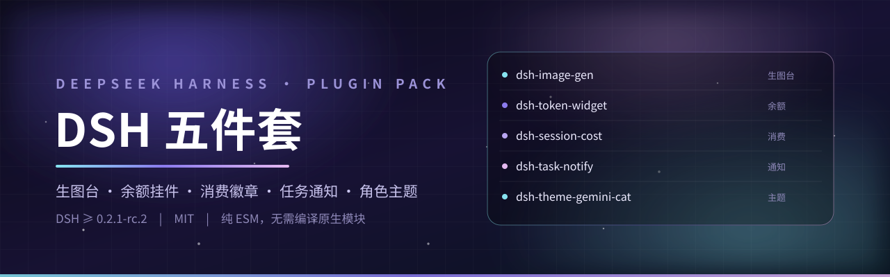
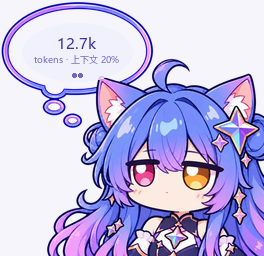
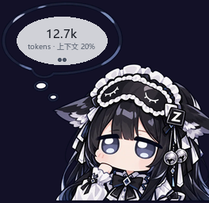

<div align="center">

<picture>
  <source media="(prefers-color-scheme: dark)" srcset="assets/brand/hero.svg">
  
</picture>

**给 [DeepSeek Harness](https://github.com/deepseek-ai) 的五个插件：生图台 · 余额挂件 · 消费徽章 · 任务通知 · 角色主题**

[](COMPATIBILITY.md)
[](#packages)
[](LICENSE)
[](#requirements)
[](https://github.com/SesaliaDarper/dsh-plugins-pack/releases)

[**装**](#install) · [**包一览**](#packages) · [**配置**](#config) · [**兼容性**](#compat) · [**卸载**](#uninstall) · [**FAQ**](#faq)

</div>

五个包互相独立：可以只装一个，也可以一起装。它们注入的是不同的 slot / 不同的宿主服务，不抢同一个位置，
也不会互相改对方的状态。全部**纯 ESM + 客户端 bundle**，不用编译原生模块。

<a id="quick-look"></a>

## 👀 长什么样

<div align="center">

| 余额挂件 · 用量页 | 余额挂件 · 余额页 | 深色 · 用量页 | 深色 · 余额页 |
| :---: | :---: | :---: | :---: |
|  |  |  |  |
| Gemini 猫猫 · 浅色 | Gemini 猫猫 · 余额 | GLM · 深色 | GLM · 余额 |

<sub>气泡两页：一页本会话 token / 上下文占用，一页账户余额 —— 默认自动翻页，点一下就把当前页钉住。</sub>

</div>

<a id="packages"></a>

## 📦 包一览

| 包 | 一句话 | 界面位置 | 平台 |
| --- | --- | --- | --- |
| [`dsh-image-gen`](packages/dsh-image-gen) | `image_generate` 工具 + `/image` 命令 + 一页独立的**生图台**（成图墙、参考图、灯箱、按会话隔离）+ 「设置 → 生图」 | 左栏「生图」入口 | 全平台 |
| [`dsh-token-widget`](packages/dsh-token-widget) | 右下角角色立绘 + 气泡：**token 用量 / 账户余额** 两页翻，可拖动、可缩放、可换立绘 | 全局浮层 | 全平台 |
| [`dsh-session-cost`](packages/dsh-session-cost) | 会话标题栏金额徽章：本会话在 **DeepSeek 官方模型**上花了多少钱（官方人民币 / 美元两份价目表，区分高峰空闲） | 会话标题栏右侧 | 全平台 |
| [`dsh-task-notify`](packages/dsh-task-notify) | 每轮对话结束在 Windows 右下角弹一条**跟随主题**的通知，逐像素 alpha 圆角，6.5 秒自散，最多叠 4 条 | Windows 桌面右下角 | **仅 Windows** |
| [`dsh-theme-gemini-cat`](packages/dsh-theme-gemini-cat) | 整套换装：侧栏立绘 + 极简对话背景 + 品牌标识 + 强调色，**Gemini 猫猫 / GLM / Grok娘 / GPT娘 / Claude娘**，深浅两套 | `设置 → 通用 → 自定义主题` | 全平台 |

<details>
<summary><b>⚠️ 两个使用前提（点开看）</b></summary>

- **`dsh-task-notify` 只在 Windows 弹窗**：走 Win32 分层窗口自绘（`WS_EX_LAYERED` + `UpdateLayeredWindow`），
  卡片渲染用 numpy + Pillow。macOS / Linux 上它会装载成功但不弹窗 —— 不想留无用插件就别装它。
- **`dsh-image-gen` 要用你自己的生图端点**：装完在「设置 → 生图」填 `baseURL` 与**密钥引用名**，
  真正的密钥值写进 `$DSH_HOME/.credentials.yaml` 的 refs 节（配置里只有引用名，永远不存明文）。
  包里 patch 的 `baseURL` 只是示例，换成任意 OpenAI 兼容的 `/v1` 端点即可。
  另：生图模型**不要**挂进 `llm-pi-ai` 的 providers —— 那是给对话模型走 `/chat/completions` 的。

</details>

<a id="requirements"></a>

## 🧩 环境要求

| 要求 | 说明 |
| --- | --- |
| **DSH Desktop ≥ 0.2.1-rc.2** | 五个包都在 `0.2.1-rc.2` 上实测通过，记录见 [COMPATIBILITY.md](COMPATIBILITY.md) |
| **pnpm** | 安装脚本优先用 DSH 自带的那份（`$DSH_HOME/dsh-runtimes/*/dependencies/pnpm`），其次找 PATH 上的 `pnpm` |
| Python（仅通知） | numpy + Pillow —— DSH 自带运行时的 Python 已带齐；系统 Python 只在兜底时用 |
| 网络（仅生图） | 需要能访问你自己填的生图端点；端点不通时只有它不可用，其余四个照常 |

每个 `package.json` 都声明了 `engines.dsh: ">=0.2.1-rc.2 <0.3.0"`。DSH 装载 / 安装插件时会拿运行时版本比对，
不匹配就在插件页明确提示 —— 不会静默出错。升级到 0.3 之前请先改这个范围并回归一遍。

<a id="install"></a>

## 🚀 一键安装

> **先完全退出 DSH Desktop**（托盘图标右键退出），否则 profile 目录被占用，`pnpm` 会失败。
> 脚本每一步都留了 `.bak-<时间戳>` 备份，随时可回滚。

<table>
<tr><td width="50%" valign="top">

**Windows（PowerShell 7 / 5.1）**

```powershell
git clone https://github.com/SesaliaDarper/dsh-plugins-pack.git
cd dsh-plugins-pack
pwsh -File scripts/install.ps1
```

</td><td width="50%" valign="top">

**macOS / Linux**

```bash
git clone https://github.com/SesaliaDarper/dsh-plugins-pack.git
cd dsh-plugins-pack
bash scripts/install.sh
```

</td></tr>
</table>

只装其中一个：

```powershell
pwsh -File scripts/install.ps1 -Only dsh-image-gen
```

```bash
bash scripts/install.sh dsh-image-gen
```

脚本做四件事，全部可回滚：

1. 把 `packages/<包名>` 拷到 `<DSH_HOME>/profiles/desktop/<包名>`（已存在则先改名备份）
2. 备份 `profiles/desktop/package.json`
3. `dependencies` 写 `"<包名>": "file:./<包名>"`，`dsh.profile.bundles` 追加包名（去重、保留原有顺序）
4. 在 profile 目录跑 `pnpm install`，把包链接进 `profiles/desktop/node_modules`

装完启动 DSH：右下角出现挂件、标题栏出现金额、左栏出现「生图」、设置里出现「自定义主题」。
`dsh-task-notify` 不需要任何设置，下一轮对话结束就会弹。

<details>
<summary><b>手动安装（不用脚本）</b></summary>

```bash
# 1. 拷包
cp -r packages/dsh-session-cost ~/.dsh/profiles/desktop/

# 2. 改 ~/.dsh/profiles/desktop/package.json，加两处
#    "dependencies": { "dsh-session-cost": "file:./dsh-session-cost" }
#    "dsh": { "profile": { "bundles": [ ..., "dsh-session-cost" ] } }

# 3. 装依赖
cd ~/.dsh/profiles/desktop && pnpm install
```

`dsh.profile.bundles` 的顺序就是 patch 叠加顺序，放在 `@deepseek-ai/dsh-base`、`@deepseek-ai/dsh-web-app` **之后**即可。

也可以走官方 CLI（它会自己把声明了 `dsh.bundle` 的包加进 `bundles`）：

```bash
node "<DSH安装目录>/resources/app/dsh/node_modules/@deepseek-ai/dsh/lib/bin.js" \
  plugin --profile desktop add file:/绝对路径/dsh-session-cost
```

</details>

<a id="uninstall"></a>

## 🗑 卸载

```powershell
pwsh -File scripts/uninstall.ps1                        # 五个都卸
pwsh -File scripts/uninstall.ps1 -Only dsh-token-widget # 只卸一个
```

```bash
bash scripts/uninstall.sh dsh-token-widget
```

卸载 = 从 `dependencies` / `dsh.profile.bundles` 摘掉 + 删目录 + 重跑 `pnpm install`（manifest 改动前先备份）。

也可以**不卸载**，直接从**侧栏 → 插件**页把对应组合包关掉：patch 立刻退出组合，立绘 / 徽章 / 主题当场消失，文件留在原地。

<a id="config"></a>

## ⚙️ 配置

五个包的配置都写在 `~/.dsh/profiles/desktop/cordis.patch.yml` 里，用 id 定位。

<details>
<summary><b><code>dsh-image-gen</code> — 接口地址、密钥引用名、输出目录</b></summary>

```yaml
- id: image-gen
  config:
    baseURL: https://your-endpoint.example/v1   # 任意 OpenAI 兼容 /v1 生图端点
    apiKeyEnv: YOUR_IMAGE_API_KEY_REF           # 只写引用名；值放 $DSH_HOME/.credentials.yaml 的 refs 节
    models: [gpt-image-2.5, grok-imagine-image-2.0]
    model: gpt-image-2.5
    defaultSize: 1024x1024
    outputDir: dsh-images                       # 相对路径按会话工作目录解析
    studioDir: ""                               # 生图台输出目录；留空 = $DSH_HOME/image-studio
    maxImages: 4
```

`baseURL` / `apiKeyEnv` / `models` / `model` / `defaultSize` / `studioDir` / `maxImages` 都是 **volatile** 字段，
会直接投影成「设置 → 生图」里的表单，改完立刻生效，不用手改 YAML。`timeoutMs` 不是 volatile，只能改文件。

</details>

<details>
<summary><b><code>dsh-session-cost</code> — 计价路由、币种、节假日、价目表覆盖</b></summary>

```yaml
- id: session-cost
  config:
    providers: [deepseek-official, deepseek-account]  # 算作「官方」的路由；其它只计数不计价
    displayCurrency: CNY        # CNY 或 USD，两份官方价目表各自计费，不做汇率折算
    holidays: ['2026-10-01']    # 中国法定节假日（沪时），按空闲时段计价
    offPeakFactor: 0.5          # 空闲价 = 高峰价 × 0.5
    pricing: []                 # 价目表覆盖项：只写要改的模型/字段
    statusRoute: true           # 是否开 GET /api/dsh-session-cost/status 自检口
```

只读自检口：`GET /api/dsh-session-cost/status` —— 报装载状态、当前价目表、折叠计数器，以及每个会话的 `sessionCost` 视图。

</details>

<details>
<summary><b><code>dsh-token-widget</code> / <code>dsh-task-notify</code> / <code>dsh-theme-gemini-cat</code></b></summary>

```yaml
- id: token-widget       # 立绘、缩放、气泡页、显示/隐藏 —— 都在挂件面板里点，落浏览器 localStorage
  config: { ... }

- id: task-notify        # 停留时长、文案、立绘，都在 lib/index.js 顶部；常驻配置只有开关
  config: { ... }

- id: theme-gemini-cat   # 主题选择、对话背景透明度、背景磨砂度 —— 在「设置 → 通用 → 自定义主题」里调
  config: { ... }
```

</details>

各包的完整字段说明：

| 包 | 文档 |
| --- | --- |
| 生图 | [packages/dsh-image-gen/README.md](packages/dsh-image-gen/README.md) |
| 余额挂件 | [packages/dsh-token-widget/README.md](packages/dsh-token-widget/README.md) |
| 消费徽章 | [packages/dsh-session-cost/README.md](packages/dsh-session-cost/README.md) |
| 任务通知 | [packages/dsh-task-notify/README.md](packages/dsh-task-notify/README.md) |
| 美化包 | [packages/dsh-theme-gemini-cat/README.md](packages/dsh-theme-gemini-cat/README.md) |

<a id="compat"></a>

## ✅ 兼容性

在**独立的 DSH_HOME + 全新生成的 profile** 里装齐五个包实测（不掺作者本机配置，换成你也能复现）：

| 检查 | 结果 |
| --- | --- |
| profile 组合树 | 五行 insert 全部落在组合末尾 |
| 客户端 bundle | 74 个条目全进 `batches`，五个包均 HTTP 200 正常下发 |
| 宿主能力 | `session-cost` 投影 200 · `task-notify` 主题口 405（路由在） · `image-gen` 真文件 200 `image/png` |
| 离线自检 | `dsh-image-gen` 的 `node tools/verify.mjs` → **95 / 95 通过** |
| 脚本 | 装 / 卸各跑一遍，卸载后 manifest 精确回到基线 |

完整记录（环境、每一项的方法与证据、DSH 升级时该盯的契约）：[**COMPATIBILITY.md**](COMPATIBILITY.md)

<a id="faq"></a>

## ❓ FAQ

<details>
<summary><b>装完没反应？</b></summary>

1. 确认装之前**完全退出**了 DSH（含托盘），装完再启动；
2. 看 `<DSH_HOME>/profiles/desktop/package.json` 的 `dsh.profile.bundles` 里有没有包名；
3. 侧栏 → 插件页，确认对应组合包是开启状态；
4. 生图台不出现，多半是 `baseURL` / 密钥引用名没填对 —— 设置里改完立刻生效，不用重启。

</details>

<details>
<summary><b>会不会拖慢 DSH / 影响别的插件？</b></summary>

五个包都是客户端 slot 或独立宿主服务，不替换任何 DSH 核心模块，也不写 `!important` 去盖原生样式
（主题的所有规则都以 `body[data-gc-theme]` 为前提，关掉即完全回到原生）。
`dsh-task-notify` 的弹窗是独立常驻子进程，空闲时不画帧。

</details>

<details>
<summary><b>金额 / 余额到底从哪来？</b></summary>

- **消费徽章**：不额外请求任何接口，折叠**已有**的会话日志（`assistant/message` 的 usage、
  `request/header` 的路由、`compaction/*` 的压缩调用），按官方价目表算。
- **余额挂件**：读 DSH 已有的账号 / 余额接口，不夹带额外请求。

</details>

<details>
<summary><b>DSH 升级到 0.3 之后还能用吗？</b></summary>

每个包都写了 `engines.dsh: ">=0.2.1-rc.2 <0.3.0"`，0.3 上会被 DSH 拦下并提示（不会静默坏）。
真要用，先改这个范围，再按 [COMPATIBILITY.md](COMPATIBILITY.md) 里「依赖的 DSH 契约」一节逐项回归。

</details>

<details>
<summary><b>素材与授权</b></summary>

MIT。立绘与主题素材随包分发，供个人在本机 DSH 里使用。

</details>

## 🗂 目录结构

```
packages/
  dsh-image-gen/          生图（image_generate 工具 + /image 命令 + 生图台 + 设置专区）
  dsh-token-widget/       余额挂件（lib/client.js 由 tools/build.mjs 从 src/client.template.js 生成）
  dsh-session-cost/       消费徽章（lib/fold.js + lib/pricing.js 是纯函数，可单测）
  dsh-task-notify/        任务通知（Host 监听 turn/end，lib/popup.py 自绘 Win32 分层窗口）
  dsh-theme-gemini-cat/   美化包（立绘以 data URL 内联进 lib/client.js）
scripts/
  install.ps1 / install.sh      一键安装
  uninstall.ps1 / uninstall.sh  一键卸载
assets/brand/hero.svg     仓库题图
COMPATIBILITY.md          兼容性实测记录（版本、检查项、证据）
```

每个包的 `cordis.patch.yml` 是一层 bundle patch，只做一件事：把插件 insert 进 profile 树。

<div align="center">
<sub>MIT © SesaliaDarper · 为 DeepSeek Harness 而做</sub>
</div>
