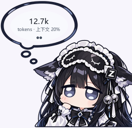

# DSH 四件套 · dsh-plugins-pack

四个给 **DeepSeek Harness（DSH）** 用的插件：会话里**看余额**、会话里**看消费**、**任务完成弹通知**，以及一套**角色美化主题**。
四个包互相独立，可以只装其中一个，也可以一起装 —— 它们注入的是不同的 slot / 不同的宿主服务，不会抢同一个位置。

| 包 | 名字 | 作用 | 界面位置 |
| --- | --- | --- | --- |
| [`dsh-token-widget`](packages/dsh-token-widget) | 余额挂件 | 右下角 Q 版角色立绘 + 气泡：一页本会话 token/上下文占用，一页**账户余额**，默认自动翻页；点立绘开面板换角色、看余额明细 | 全局浮层（可拖动，位置记在浏览器本地） |
| [`dsh-session-cost`](packages/dsh-session-cost) | 会话费用徽章 | 会话标题栏一枚金额徽章：本会话在 DeepSeek 官方模型上花掉多少钱（官方人民币/美元价目表，区分高峰/空闲时段），点开看明细 | 会话标题栏右侧 |
| [`dsh-task-notify`](packages/dsh-task-notify) | 任务完成通知 | 每轮对话结束在 Windows 右下角弹一条通知：配色跟随 DSH 当前设计 token，立绘跟随当前主题，逐像素 alpha 圆角，6.5 秒自动消失，最多堆叠 4 条 | Windows 桌面右下角 |
| [`dsh-theme-gemini-cat`](packages/dsh-theme-gemini-cat) | 美化包 | 角色立绘 + 极简对话背景 + 主题 logo + 强调色：Gemini 猫猫 / GLM / Grok娘 / GPT娘 / Claude娘，深浅两套，透明度与磨砂可调 | `设置 → 通用 → 自定义主题` |

> `dsh-task-notify` 是四个里唯一的 **Windows 专用**包：弹窗走 Win32 分层窗口自绘（`WS_EX_LAYERED` +
> `UpdateLayeredWindow`），卡片渲染用 numpy + Pillow。在 macOS / Linux 上它会装载成功但不弹窗 ——
> 想省事就别装它（`-Only` / 传包名即可）。





---

## 环境要求

- **DSH Desktop ≥ 0.2.1-rc.2**（四个包都实测在 `0.2.1-rc.2` 上跑通，见 [COMPATIBILITY.md](COMPATIBILITY.md)）
- Windows / macOS 均可；插件是纯 ESM + 客户端 bundle，不需要编译原生模块（`dsh-task-notify` 仅 Windows 有弹窗）
- 装依赖需要 `pnpm`：脚本会优先用 DSH 自带的那份，其次找 PATH 上的 `pnpm`
- `dsh-task-notify` 额外需要 numpy + Pillow —— DSH 自带运行时里的 Python 已经带齐；系统 Python 只在兜底时用

四个包的 `package.json` 都写了 `engines.dsh: ">=0.2.1-rc.2 <0.3.0"`。
DSH 在装载/安装插件时会拿它比对运行时版本，不匹配会在插件页给出提示 —— 不会静默出错。

## 一键安装

> 装之前请**完全退出 DSH Desktop**（托盘图标也要退），否则 profile 目录被占用。

### Windows（PowerShell 7 / 5.1）

```powershell
git clone https://github.com/SesaliaDarper/dsh-plugins-pack.git
cd dsh-plugins-pack
pwsh -File scripts/install.ps1
```

只要其中一个：

```powershell
pwsh -File scripts/install.ps1 -Only dsh-session-cost
```

### macOS / Linux

```bash
git clone https://github.com/SesaliaDarper/dsh-plugins-pack.git
cd dsh-plugins-pack
bash scripts/install.sh
# 只装一个：
# bash scripts/install.sh dsh-theme-gemini-cat
```

脚本做四件事，全部可回滚：

1. 把 `packages/<包名>` 拷到 `~/.dsh/profiles/desktop/<包名>`（已存在则先备份成 `.bak-<时间戳>`）
2. 备份 `profiles/desktop/package.json`
3. 往 `dependencies` 写 `"<包名>": "file:./<包名>"`，往 `dsh.profile.bundles` 追加包名（去重、保留原有顺序）
4. 在 profile 目录跑 `pnpm install`，把这四个包链接进 `profiles/desktop/node_modules`

装完启动 DSH，右下角/标题栏/设置里就能看到效果。

## 手动安装（不用脚本）

```bash
# 1. 拷包
cp -r packages/dsh-session-cost ~/.dsh/profiles/desktop/

# 2. 改 ~/.dsh/profiles/desktop/package.json，加两处
#    "dependencies": { "dsh-session-cost": "file:./dsh-session-cost" }
#    "dsh": { "profile": { "bundles": [ ..., "dsh-session-cost" ] } }

# 3. 装依赖
cd ~/.dsh/profiles/desktop && pnpm install
```

`dsh.profile.bundles` 里的顺序就是 patch 叠加顺序，放在 `@deepseek-ai/dsh-base`、`@deepseek-ai/dsh-web-app` **之后**即可。

> 也可以用官方 CLI 装（它会自己把 `dsh.bundle` 声明的包加进 `bundles`）：
> `node "<DSH安装目录>/resources/app/dsh/node_modules/@deepseek-ai/dsh/lib/bin.js" plugin --profile desktop add file:/绝对路径/dsh-session-cost`

## 卸载

```powershell
pwsh -File scripts/uninstall.ps1                       # 三个都卸
pwsh -File scripts/uninstall.ps1 -Only dsh-token-widget
```

```bash
bash scripts/uninstall.sh dsh-token-widget
```

卸载 = 从 `dependencies` / `dsh.profile.bundles` 里摘掉 + 删目录 + 重跑 `pnpm install`。
`package.json` 改动前脚本会先备份。

也可以不卸载，直接从**侧栏 → 插件**页把对应组合包关掉：patch 立刻退出组合，
立绘/徽章/主题都会消失，文件留在原地。

## 配置

四个包的配置都写在 `~/.dsh/profiles/desktop/cordis.patch.yml` 里，用 id 定位：

```yaml
- id: token-widget            # dsh-token-widget
  config: { ... }

- id: session-cost            # dsh-session-cost
  config:
    providers: [deepseek-official, deepseek-account]
    displayCurrency: CNY     # 或 USD
    holidays: ['2026-10-01'] # 中国法定节假日，按空闲时段计价
    pricing: []              # 价目表覆盖项

- id: task-notify             # dsh-task-notify
  config: { ... }

- id: theme-gemini-cat        # dsh-theme-gemini-cat
  config: { ... }
```

`dsh-session-cost` 还带一个只读自检口：`GET /api/dsh-session-cost/status`
（报装载状态、当前价目表、折叠计数器，以及每个会话的 `sessionCost` 视图）。
关掉自检口：`config.statusRoute: false`。

各包 README 里有完整字段说明：

- [余额挂件 README](packages/dsh-token-widget/README.md)
- [会话费用徽章 README](packages/dsh-session-cost/README.md)
- [任务完成通知 README](packages/dsh-task-notify/README.md)
- [美化包 README](packages/dsh-theme-gemini-cat/README.md)

## 目录结构

```
packages/
  dsh-token-widget/       余额挂件（lib/client.js 由 tools/build.mjs 从 src/client.template.js 生成）
  dsh-session-cost/       会话费用徽章（lib/fold.js + lib/pricing.js 是纯函数，可单测）
  dsh-task-notify/        任务完成通知（Host 侧监听 turn/end，lib/popup.py 自绘 Win32 分层窗口）
  dsh-theme-gemini-cat/   美化包（立绘以 data URL 内联进 lib/client.js）
scripts/
  install.ps1 / install.sh      一键安装
  uninstall.ps1 / uninstall.sh  一键卸载
COMPATIBILITY.md          兼容性实测记录（版本、检查项、证据）
```

每个包的 `cordis.patch.yml` 是一层 bundle patch，只做一件事：把插件 insert 进 profile 树。

## 许可

MIT。立绘与主题素材随包分发，供个人在本机 DSH 里使用。
